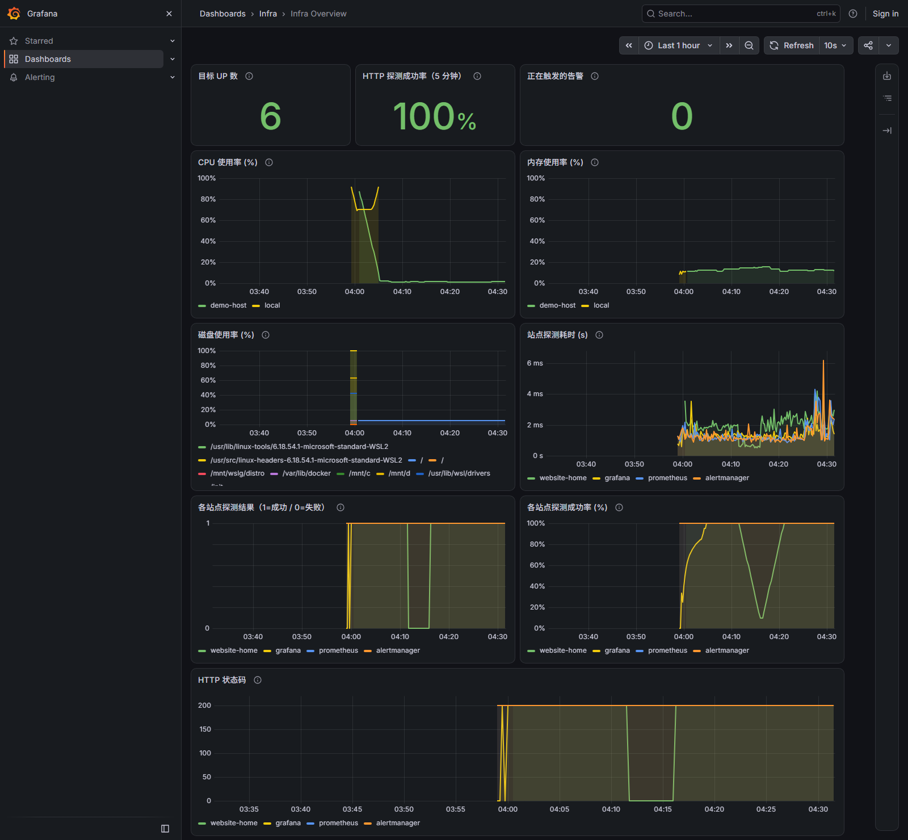
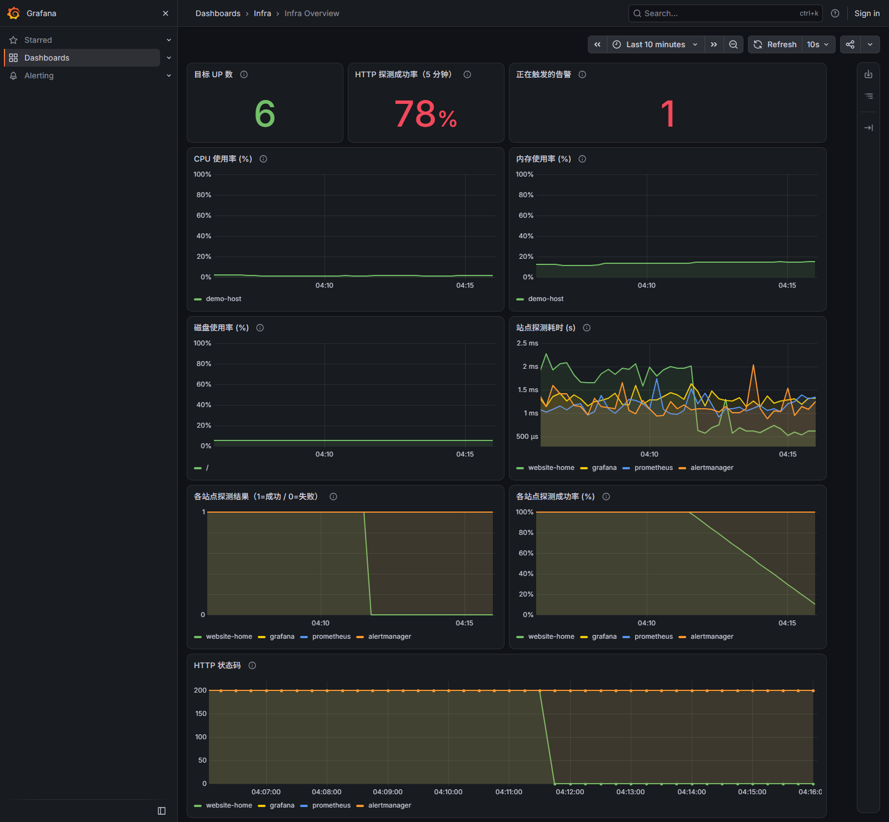
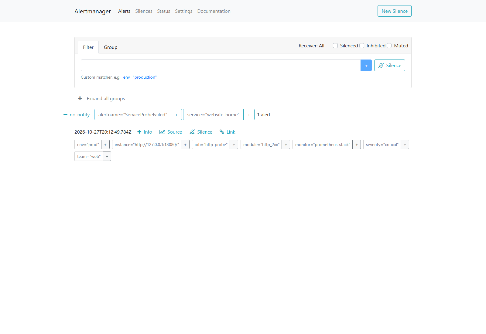

# Prometheus Stack

[](https://github.com/miku00-01/prometheus-stack/actions/workflows/ci.yml)

用于单台 Linux 主机的监控练习：Prometheus 采集指标，node-exporter 提供主机指标，Blackbox Exporter 探测 HTTP 站点，Alertmanager 处理告警，Grafana 展示数据。项目使用这些开源组件；本仓库提供编排、目标清单、规则、看板和验收脚本，并未开发这些组件本身。

> **只支持 Linux 宿主机。** 本项目使用 host 网络并挂载 `/proc`、`/sys` 读取主机指标，Mac/Windows 上的 Docker Desktop 无法运行；Windows 请使用 WSL2，其他系统请准备一台 Linux 虚拟机（或直接使用 Linux 服务器）。

架构关系见 [单机监控架构](docs/architecture.md)。

**用途边界：**适合个人实验与小规模演示，不提供高可用、异地备份或公网可用性保证。从同一台服务器探测 `127.0.0.1` 只能证明该服务器本地的 HTTP 服务可用。

## 运行要求

| 项目 | 要求 |
|---|---|
| 主机 | 一台 Linux 服务器（x86_64 或 arm64），建议至少 2 GB 内存、10 GB 磁盘 |
| 软件 | Docker Engine、Docker Compose CLI 插件、Python 3、curl；`openssl`、`crontab` 可选 |
| 权限 | root，或 docker 组用户；否则用 `sudo bash install.sh` |
| 端口 | 3000、9090、9093、9100、9115 空闲；公开访问另需 80/443，或 `--public :8080` |
| 网络 | 能拉取 5 个监控镜像（公开访问再需 `caddy:2.10.0`）；能访问要探测的站点；配邮件时能连 SMTP |
| 可选 | 公开访问需要域名解析到本机，并在云安全组放行 80/443 |

本安装器用于**空闲主机**，检测到端口占用会在写入配置前停止。如果主机上已有 Prometheus/Grafana，请看 [现有监控接入说明](docs/EXISTING_STACK.md)，不要运行 `install.sh` 覆盖它。

所有 Web 服务默认仅监听 `127.0.0.1`。使用 SSH 隧道查看，不要开放这些监控端口到公网。

## 快速开始

先获取代码：`git clone https://github.com/miku00-01/prometheus-stack && cd prometheus-stack`，或解压发布包后进入目录。然后运行：

```bash
bash install.sh
```

脚本会生成随机 Grafana 管理员密码，保存到不入库的 `.env`（权限 600），**不会在终端打印密码**。如需查看，请只在自己控制的终端读取。安装器不会接受密码、邮箱授权码等命令行参数；装完会提示是否添加站点、配置邮件，默认还写入一条 crontab 同步任务（`--no-sync` 可跳过），改完 `cmdb/services.json` 最多一分钟自动生效。

安装完成后，至少执行以下检查：

```bash
curl -fsS http://127.0.0.1:9090/-/ready
curl -fsS http://127.0.0.1:3000/api/health
bash scripts/check.sh
```

默认 Alertmanager 只展示告警，**不会发送通知**。邮件要另行配置并验证。

## 监控面板

安装并运行几分钟后，打开 `http://127.0.0.1:3000/d/infra-overview`（通过 SSH 隧道），一页就能看到主机与站点的状态：



看板顶部是三个结论：采集目标 UP 数、HTTP 探测成功率（5 分钟）、正在触发的告警。下面依次是 CPU 使用率、内存使用率、磁盘使用率、站点探测耗时、各站点探测结果、各站点成功率和 HTTP 状态码。没有告警时显示 `0`，不会留白；耗时与状态码量纲不同，分别成图。「采集目标 UP 数」只统计 Prometheus 抓取成功的对象，不代表你的网站可用——站点是否可用看 HTTP 探测成功率与探测结果。

站点不可用时，同一页会显示失败和触发的告警：





这些截图取自本仓库真实运行的 Prometheus、Alertmanager 和 Grafana（单机 Compose；看板图顶部各自标注了时间窗，主机名 `demo-host`、站点 `website-home` 为演示占位值），不是示意图。故障演练的说明见[发布与验收](#发布与验收)。

## 在 Mac/Windows 上只看界面（演示）

完整功能仍然只支持 Linux。如果只想在 Docker Desktop 上看清页面和告警效果，可以用单独的演示编排（不改动正式配置）：

```bash
GRAFANA_PASSWORD=demo-only-pass docker compose -f docker-compose.desktop.yml up -d
```

打开 `http://127.0.0.1:3000`，用 `admin` / `demo-only-pass` 登录。看板布局和告警流程与正式版一致，但要清楚它只是界面演示：

- 主机指标来自 Docker 的 Linux 虚拟机，不是你的 Mac/Windows 主机；
- 探测目标是栈内的 Prometheus、Alertmanager、Grafana，不是你的网站；
- 只有 3000/9090/9093 可以从浏览器访问；9100（node-exporter）和 9115（blackbox）只在栈内可达，`curl 127.0.0.1:9100/metrics` 连不上是正常的；
- 使用独立的 Compose 项目名，先停掉正式栈再启动，避免端口冲突；
- 停止：`docker compose -f docker-compose.desktop.yml down`。

这个模式只用于预览界面，不能拿它做验收或对外演示。

## 添加自己的站点

安装器首次运行会从 `cmdb/services.json.example` 生成本地 `cmdb/services.json`。运行下面的引导命令，输入网站在**探测器所在服务器**能访问的地址。它会备份旧清单、启用 `website-home` 并渲染目标：

```bash
python3 cmdb/setup_site.py
```

示例文件中网站目标默认关闭，避免刚安装就误报。要添加多个服务，编辑 `cmdb/services.json` 后运行 `python3 cmdb/render_targets.py`。脚本校验清单后原子更新 `prometheus/targets/*.json`，Prometheus 的 `file_sd` 会在约 30 秒内读取变化。清单无效时，旧目标文件会保留。默认安装会写入 crontab，每分钟自动渲染一次清单；用 `--no-sync` 安装、或希望改完立即生效时，再手动运行 `python3 cmdb/render_targets.py`。不要在 URL 中放账号、令牌或查询参数。

用 Prometheus 查询 `probe_success{job="http-probe"}`。值为 1 表示探测成功，值为 0 表示失败；还应核对目标的 HTTP 状态和响应耗时。

## 163 邮箱告警

先在 163 邮箱网页端开启 SMTP 并取得**客户端授权码**。在服务器项目目录运行：

```bash
bash scripts/configure-email.sh
```

脚本交互询问发件邮箱、收件邮箱、SMTP 主机与端口，授权码输入时不回显。默认主机为 `smtp.163.com`、端口 465；其他邮箱可输入自己的 SMTP 参数。授权码单独存放在被 `.gitignore` 排除的 `alertmanager/secrets/smtp_password`，不会进入命令历史或 `alertmanager.yml`。脚本备份旧配置、用 `amtool` 校验后只重建 Alertmanager 容器。

先用 `bash scripts/test-alert.sh` 验证邮件能送达。脚本只做参数与权限检查，邮件最终是否送达取决于 SMTP 与邮箱设置，以实际收件为准。**这仅测试通知链路**；还要通过安全的测试目标触发和恢复一次 `ServiceProbeFailed`，确认告警与 resolved 邮件都收到，才算网站告警闭环完成。不要通过停止真实网站来测试。

默认的 `no-notify` 接收器不配置 `inhibit_rules`，同一个站点可能同时收到 `ServiceProbeFailed`（critical）和 `ServiceProbeSlow`（warning）。切到邮件接收器后，建议参考 `alertmanager/alertmanager.yml.example` 里的 `inhibit_rules`，在 `ServiceProbeFailed` 触发时抑制该站点的 `ServiceProbeSlow`，避免重复打扰；抑制只影响通知，不会隐藏看板或 Alertmanager 页面里的告警。

## 私有访问

在自己的电脑上建立 SSH 隧道，例如：

```bash
ssh -N -L 127.0.0.1:3000:127.0.0.1:3000 user@server
```

再打开 `http://127.0.0.1:3000/`。端口 9090、9093 可按相同方式单独转发。默认模式是最安全的用法；确实要给别人看时，用下一节的公开访问，而不是手动改端口绑定。

## 公开访问（可选）

如果希望别人直接通过浏览器打开你的看板，而不必各自建 SSH 隧道：

```bash
# 有域名：Caddy 自动申请并续期 TLS 证书，只监听 80/443
sudo bash install.sh --public monitor.example.com

# 没有域名：纯 HTTP，监听指定端口（密码会明文传输，只适合临时演示）
sudo bash install.sh --public :8080
```

这条命令只把 **Grafana** 放出去，并且在外面加了一层：

- Caddy 反向代理到仍然只监听 `127.0.0.1:3000` 的 Grafana；Prometheus、Alertmanager、node-exporter、Blackbox 的端口一个都不对外。
- 访问先过 Caddy Basic Auth（用户名默认 `admin`，密码随机生成，存在 `.env` 的 `CADDY_AUTH_PASSWORD`，不在终端打印）。
- 通过认证的访客在 Grafana 里是**只读匿名用户**（Viewer），不能改看板、不能看用户列表；管理员仍用 `admin` + `GRAFANA_PASSWORD` 登录。
- 域名模式自动 HTTPS；响应带 `X-Content-Type-Options: nosniff`、`X-Frame-Options: SAMEORIGIN` 等基础安全头。证书和配置存在 `caddy-data`、`caddy-config` 卷里，重装不会重复签发。

装完终端会打印打开地址。打不开时依次检查：DNS 是否已解析到本机、云安全组/防火墙是否放行 80 和 443、`docker compose logs --tail=50 caddy` 里的证书申请结果。

想收回对外入口，重新运行一次不带 `--public` 的安装：

```bash
bash install.sh
```

安装器会移除 caddy 容器并把匿名访问关掉，Grafana 回到只监听回环的状态。公开访问仍然只是单机练习用途：Basic Auth 是最简单的一层口令保护，没有速率限制和二次验证，不要把管理后台当成面向互联网的生产服务。


## 日常操作与回滚

| 任务 | 命令 |
|---|---|
| 查看目标与告警 | `bash scripts/check.sh` |
| 终端查看指标 | `bash scripts/board.sh` |
| 清单变更后渲染 | `python3 cmdb/render_targets.py` |
| 引导配置一个网站 | `python3 cmdb/setup_site.py` |
| 验证规则 | `make lint`（需要 Docker 与 ShellCheck） |
| 停止本项目容器 | `bash uninstall.sh` |

`uninstall.sh` **保留** Compose 数据卷、配置和授权码文件，不执行数据删除。若使用 `make` 且当前用户必须通过 sudo 访问 Docker，可指定 `make DOCKER="sudo docker" <目标>`。

## 常见问题

- **`bash: install.sh: No such file or directory`**：当前目录不是项目根目录。`cd` 到能看到 `docker-compose.yml`、`cmdb/`、`grafana/` 的目录再运行。
- **脚本 `Permission denied`**：不需要可执行位，用 `bash scripts/check.sh` 这种形式，不要用 `./scripts/check.sh`。
- **`端口已占用`**：本机已有 Grafana/Prometheus。先 `bash uninstall.sh` 停掉本项目，或改看 [现有监控接入说明](docs/EXISTING_STACK.md)。
- **拉镜像超时**：给 Docker 配置可用的 registry mirror，再重新执行 `bash install.sh`。
- **忘记 Grafana 密码**：`grep GRAFANA_PASSWORD .env`；公开访问的 Basic Auth 密码在 `CADDY_AUTH_PASSWORD`。
- **看板没有数据**：等 1–2 分钟，用 `bash scripts/check.sh` 检查 targets；再确认 `cmdb/services.json` 里的地址在服务器上可访问。
- **收不到邮件**：默认 `no-notify` 只展示告警。先 `bash scripts/configure-email.sh`，再用 `bash scripts/test-alert.sh` 验证。
- **Grafana 首页报错或菜单变中文**：浏览器自动翻译会破坏页面，关闭该站点的翻译后刷新即可。

## 发布与验收

发布前检查 `git status` 和待提交文件。不要提交 `.env`、`cmdb/services.json`、`alertmanager/alertmanager.yml`、`alertmanager/secrets/`、实际服务器 IP、邮箱授权码、个人访问日志或截图中的凭据。

一次完整验收应记录：容器状态、Prometheus targets、网站探测由 1 变 0 再恢复 1、对应的 Alertmanager 告警、故障邮件和恢复邮件、以及故障期间的服务日志。仅通过语法检查或容器启动，不能称邮件告警已经可用。

故障演练请使用仓库自带的演示站点：先 `bash scripts/demo-site.sh start`，运行 `python3 cmdb/setup_site.py --url http://127.0.0.1:18080/ --name website-home` 把 `website-home` 指到演示站点（已有同名条目会被更新并重新渲染）；再 `bash scripts/demo-site.sh stop` 停掉它，看板中该站点的探测结果变为 0、`正在触发的告警` 变为 1，Alertmanager 出现 `ServiceProbeFailed`；`bash scripts/demo-site.sh start` 恢复后告警转为 resolved。上面的看板截图就来自这次演练，不要用真实业务站点做演练。这次演练使用默认的 `no-notify` 接收器，只验证看板与 Alertmanager 页面；要验证邮件，需要先按「163 邮箱告警」配置邮箱，再单独演练一次。

本仓库代码采用 [MIT 许可证](LICENSE)。Prometheus、Alertmanager、Blackbox Exporter、node-exporter、Grafana 各自遵循其上游许可证。
